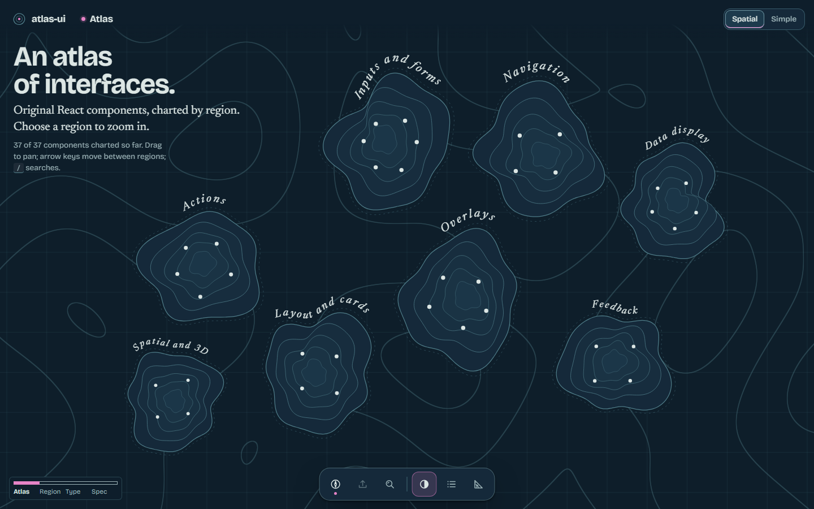
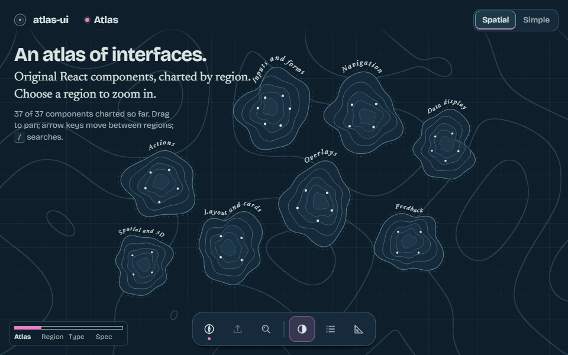
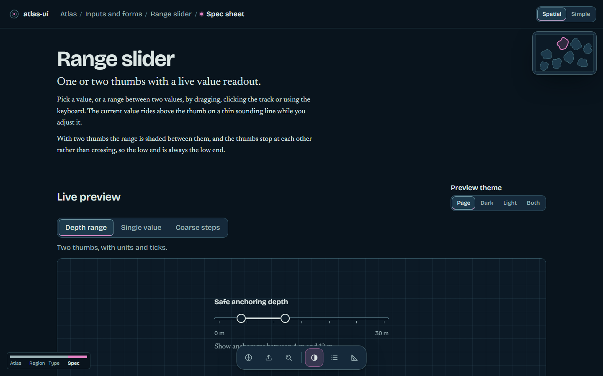
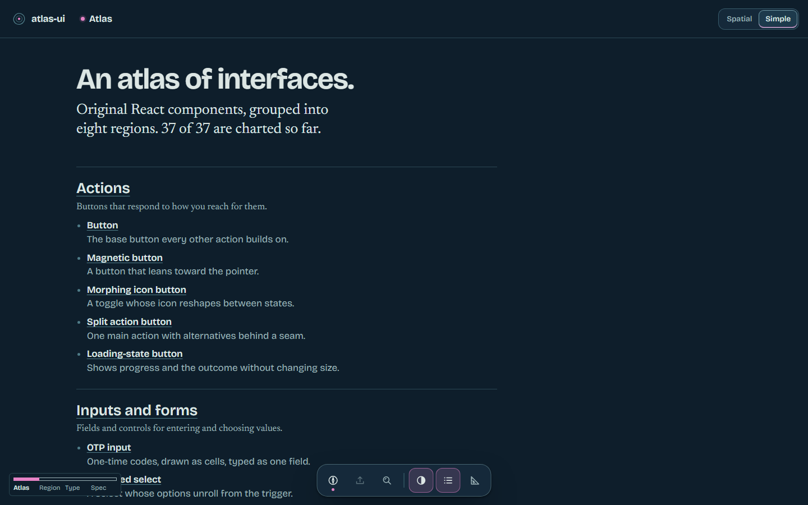

# atlas-ui

[](https://github.com/Omkar210404/Atlas-UI/actions/workflows/ci.yml)

An atlas of interfaces. 37 original, accessible React components, shown on a nautical chart you
zoom through from region to type to component, each with a live preview, props playground and
copy-paste source.

**Live site:** https://omkar210404.github.io/Atlas-UI/





## Principles

- **Original work.** Every component, icon and illustration here was made for this project.
- **Accessible by default.** Keyboard maps, focus that is always visible, ARIA where native HTML
  is not enough, and axe run on every page in both themes in CI.
- **Motion that can be turned down.** Every component documents its reduced-motion behaviour;
  the site switches to a Simple view under reduced motion, without WebGL or with data saver on.
- **3D only where it earns it.** three.js loads on demand, only for the Spatial components and
  the atlas background.
- **Copy, don't install.** Each component is a small folder you copy into your project, also
  published as registry JSON (`registry/`).

## Components

| Category | Components |
|---|---|
| Actions | Button, Loading-state button, Magnetic button, Morphing icon button, Split action button |
| Inputs and forms | Animated select, OTP input, Range slider, Segmented control, Switch, Text field |
| Navigation | Breadcrumb trail, Command palette, Floating dock, Tab bar |
| Data display | Code panel, Heat grid, Sparkline, Animated stat counter, Timeline |
| Feedback | Empty-state illustrations, Progress ring, Skeleton shimmer system, Toast stack |
| Overlays | Context menu, Drawer, Modal, Popover, Tooltip |
| Layout and cards | Bento grid, Expandable card, Parallax stack, Tilt card |
| Spatial and 3D | WebGL ambient background, 3D carousel, Depth-layers card, Cursor-reactive particle field |

| Spec sheet | Simple view |
|---|---|
|  |  |

## Measured numbers

Bundle sizes from `npm run size` on a production build (gzip). CI fails if any budget is
exceeded.

| What | Measured | Budget |
|---|---|---|
| Initial JavaScript | 104.7 KB | 110 KB |
| CSS | 11.1 KB | 25 KB |
| Preloaded fonts | 83.8 KB | 90 KB |
| three.js chunk (loaded on demand) | 291.1 KB | 300 KB |
| One component | 0.7 to 4.9 KB | 6 KB |

Tests: 378 unit and interaction tests (Vitest in real Chromium), 238 axe checks (every page and
every component in both themes, zero violations), smoke tests in Chromium, Firefox and WebKit.

Not measured yet: Lighthouse and frame timing (`npm run measure` writes `reports/perf.md`), and
no manual screen-reader pass has been done.

## Run it

Needs Node 22.12 or newer (CI uses Node 24).

```sh
npm install
npx playwright install chromium   # browser for the unit tests
npm run dev                       # http://localhost:5173/atlas-ui/
```

| Command | What it does |
|---|---|
| `npm run build` | Generates tokens, builds the library (one module per component) and the site |
| `npm run preview` | Serves the built site at http://localhost:4173/atlas-ui/ |
| `npm test` | Unit and interaction tests in real Chromium (Vitest browser mode) |
| `npm run e2e` | Playwright: axe in both themes, smoke tests in three browsers, visual snapshots |
| `npm run size` | Checks bundle budgets after a build; fails when one is exceeded |
| `npm run registry` | Rebuilds the copy-paste registry JSON |
| `npm run measure` / `npm run media` | Lighthouse and frame timing; README screenshots and GIF (needs `npm run preview`) |
| `npm run lint` / `npm run typecheck` | ESLint (with jsx-a11y) and TypeScript |

## Contributing

Issues and pull requests are welcome. A new component needs its folder under
`packages/atlas-ui/src/components/<category>/<name>/` with the component, its CSS, an `index.ts`,
a `docs.tsx` (presets, playground, keyboard map, accessibility and reduced-motion notes) and
tests. Run `npm run lint`, `npm test`, `npm run build`, `npm run size` and `npm run e2e:axe`
before opening a pull request.

## Licence

MIT for the code. Fonts are OFL-1.1; dependencies and tools are listed with their licences in
[THIRD_PARTY_LICENSES.md](THIRD_PARTY_LICENSES.md).
